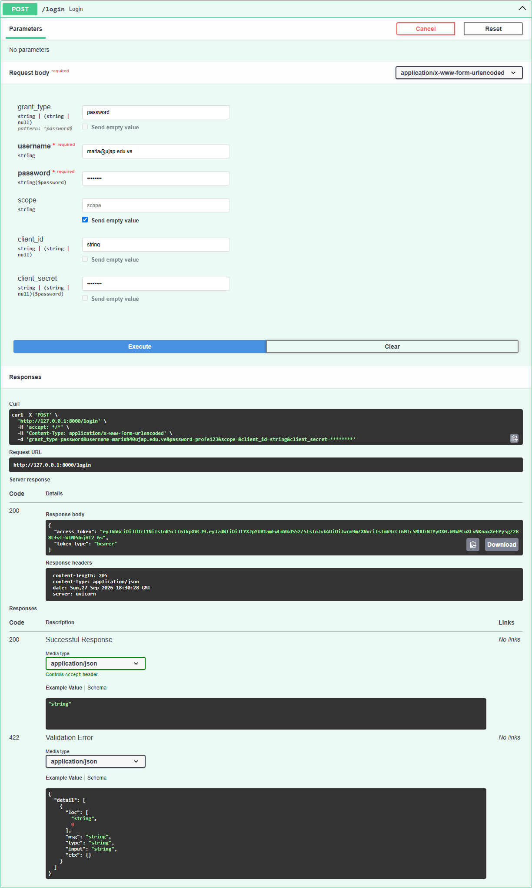
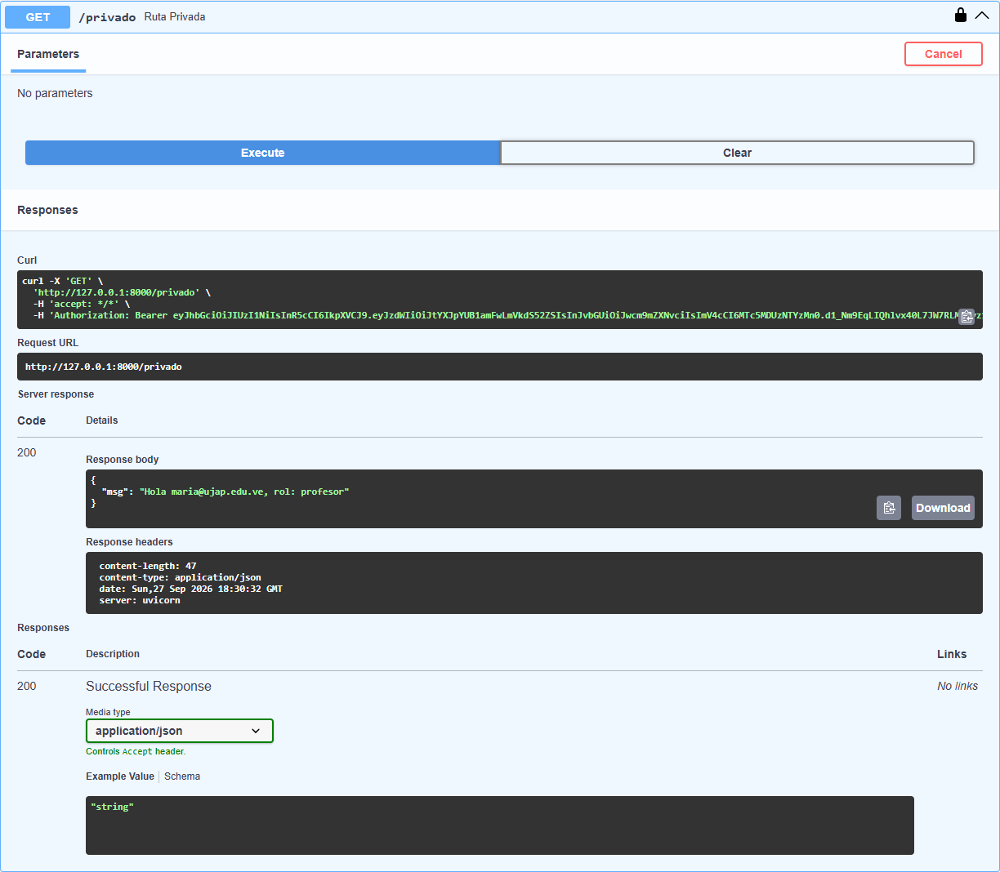

# API con JWT — FastAPI

**LPR07304 · Lenguajes de Programación · Unidad IV · Semana 10**
Actividad de entrega: Autenticación con JWT en FastAPI.

---

## Parte A — Conceptual (40%)

### P1. ¿Qué significa JWT y cuáles son sus tres partes?

**JWT** significa **JSON Web Token** (estándar RFC 7519). Es un token compacto y firmado que el servidor entrega al usuario al iniciar sesión, y que el cliente envía en cada petición (`Authorization: Bearer <token>`) para demostrar quién es. Es *stateless*: el servidor no guarda sesiones, solo verifica la firma.

Está formado por tres partes codificadas en Base64URL y separadas por puntos (`header.payload.signature`):

1. **Header:** indica el tipo de token y el algoritmo de firma. Ej.: `{"alg": "HS256", "typ": "JWT"}`.
2. **Payload:** contiene los *claims* (datos) del usuario. Ej.: `sub` (quién es), `role` (permisos) y `exp` (fecha de expiración en formato Unix).
3. **Signature:** `HMACSHA256(base64(header) + "." + base64(payload), SECRET_KEY)`. Garantiza que el token no fue modificado y que lo emitió el servidor.

### P2. ¿Por qué el payload NO es seguro para guardar contraseñas?

Porque el payload **solo está codificado en Base64, no cifrado**. Cualquier persona que obtenga el token (en el navegador, en un log o interceptando tráfico) puede decodificarlo y leer su contenido sin necesidad del `SECRET_KEY`, por ejemplo en [jwt.io](https://jwt.io) o con `base64 -d`. La firma protege la **integridad** (que no se modifique), pero **no la confidencialidad** (que no se lea). Por eso nunca se deben poner contraseñas, números de tarjeta, CVV, datos médicos ni otra información sensible en el payload; solo identificadores y permisos.

### P3. ¿Qué sucede si alguien modifica el payload sin conocer el SECRET_KEY?

El token queda **inválido**. Al recibirlo, el servidor recalcula la firma con su `SECRET_KEY` usando el header y el payload recibidos; como el payload cambió, la firma calculada **no coincide** con la firma que trae el token. `jwt.decode()` lanza una excepción `JWTError` y la API responde **401 Unauthorized** (`"Token expirado o inválido"`).

Por ejemplo, si un estudiante cambia `"role": "estudiante"` por `"role": "profesor"` para entrar a `/admin`, no puede generar una firma válida sin conocer la clave secreta, así que el ataque falla.

### P4. Diferencia entre 401 Unauthorized y 403 Forbidden. ¿Cuándo usa cada uno FastAPI?

| | **401 Unauthorized** | **403 Forbidden** |
|---|---|---|
| Significado | **No autenticado**: el servidor no sabe quién eres. | **No autorizado**: el servidor sabe quién eres, pero no tienes permiso. |
| Pregunta que falla | "¿Quién eres?" | "¿Puedes hacer esto?" |
| Solución | Iniciar sesión / enviar un token válido. | Usar una cuenta con el rol adecuado. |

En esta API:

- **401**: lo lanza `OAuth2PasswordBearer` cuando no se envía el header `Authorization` (`"Not authenticated"`), y `get_current_user` cuando el token está expirado, alterado o firmado con otra clave. También `/login` con credenciales incorrectas.
- **403**: lo lanza `/admin` cuando el token es válido pero el `role` es `"estudiante"` en lugar de `"profesor"` (`"Solo para profesores"`).

---

## Parte B — Práctica (60%)

### Estructura del proyecto

```
mi-api-jwt/
├── main.py            # Endpoints: /login, /publico, /privado, /admin
├── auth.py            # JWT (python-jose) + bcrypt (passlib)
├── .env               # SECRET_KEY (NO se sube a Git)
├── .env.example       # Plantilla del .env
├── .gitignore         # Incluye .env
├── requirements.txt
├── capturas/          # Capturas de Swagger UI
└── README.md
```

### `auth.py`

- `hash_password(password)` — genera el hash bcrypt.
- `verify_password(plain, hashed)` — compara la contraseña con el hash.
- `create_token(data)` — crea el JWT con expiración de 30 minutos, firmado con `HS256` y `SECRET_KEY`.
- `get_current_user(token)` — dependencia que extrae el Bearer token, verifica firma y expiración, y devuelve el payload (o lanza 401).

### `main.py`

| Método | Ruta | Protección | Respuesta |
|---|---|---|---|
| POST | `/login` | Pública (form-data) | `{access_token, token_type: "bearer"}` |
| GET | `/publico` | Ninguna | `{"msg": "Cualquiera puede ver esto"}` |
| GET | `/privado` | `Depends(get_current_user)` | Email y rol del usuario |
| GET | `/admin` | `Depends(get_current_user)` + rol `profesor` | 403 si el rol no es `profesor` |

### Usuarios de prueba

| Usuario | Contraseña | Rol |
|---|---|---|
| `maria@ujap.edu.ve` | `profe123` | profesor |
| `estudiante@ujap.edu.ve` | `estu123` | estudiante |

### Cómo ejecutar

```bash
python -m venv .venv
.venv\Scripts\activate          # Windows  (Linux/Mac: source .venv/bin/activate)
pip install -r requirements.txt

# Crear el .env con una clave aleatoria
copy .env.example .env          # Linux/Mac: cp .env.example .env
python -c "import secrets; print(secrets.token_hex(32))"   # pegar el resultado en SECRET_KEY

uvicorn main:app --reload
```

Swagger UI: <http://127.0.0.1:8000/docs>

---

## Capturas de Swagger UI

### ① POST /login → 200 con token



### ② GET /privado → 200 (autenticado)

Autorizado en Swagger (botón **Authorize**) como `maria@ujap.edu.ve`.



### ③ GET /admin → 403 (rol estudiante)

Autorizado en Swagger como `estudiante@ujap.edu.ve`.


